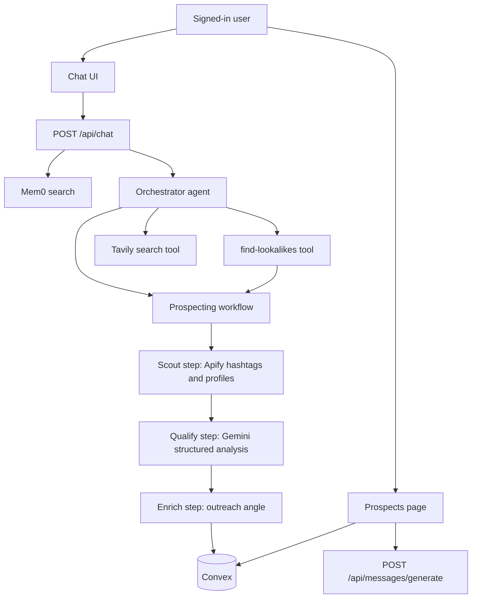

# Shiloh Prospecting

Shiloh Prospecting is a signed-in web app for finding Instagram creators, qualifying them for a partnership, and drafting outreach. A user describes a niche in chat. An orchestrator agent runs a prospecting workflow that scrapes public Instagram data, scores creators, and saves the results. The prospects page tracks status and generates DM variations.

The npm package name is `creator-scout`. The interface title is Shiloh Prospecting.

## What it does

- Chat with an orchestrator that can start a niche search, look for similar creators, or search the web.
- Scout creators from Instagram hashtags (or from a list of usernames) inside a follower range, and skip handles already saved for that user.
- Qualify creators with a structured model call on bio and stats: transformation, audience authenticity, and demographics.
- For creators marked qualified, generate an outreach angle, a monetization gap, and a short post summary.
- Save prospects in Convex, scoped by the Clerk user id when the workflow passes one through.
- Generate two styles of DM copy (direct-value variations, and short openers plus a follow-up) on the prospects page.
- Keep chat threads in Convex. Optionally store and retrieve per-user notes in Mem0.
- Adjust search defaults and edit prompt text on the settings page. Those values are saved per user. The running agents and workflow still use the prompts and defaults in source; the saved overrides are not applied at runtime.
- A test page calls the Apify actors used by the app. A debug page shows an in-browser log of client-side activity.

## Architecture



The chat route loads the Mastra orchestrator and streams its reply. The orchestrator's tools are:

| Tool | What it does |
| --- | --- |
| `start-niche-workflow` | Runs the prospecting workflow for one niche. Hashtags come from `NICHE_HASHTAG_MAP`, or from the niche name when it is not in the map. |
| `find-lookalikes` | Asks Apify for suggested accounts and hashtags related to a username, then runs the same workflow on those usernames. |
| `tavily-search` | Web search for niche research and other questions that need current information. |

The prospecting workflow is three steps:

1. **Scout.** Search hashtags or accept usernames, drop handles already stored for that user, then batch-fetch profiles and filter by follower count.
2. **Qualify.** Call `analyzeCreatorWithAgent` (Gemini via the AI Gateway, structured output) on bio and stats. This step does not fetch comments.
3. **Enrich.** For qualified creators, call `profileCreatorWithAgent` for the outreach angle, monetization gap, and post summary, then `saveProspectsBatch`.

Mastra agent objects named Scout, Analyst, and Profiler are registered on the Mastra instance. The Scout agent wraps the `scout-creators` tool, and the Analyst agent is defined with a Tavily extract tool. The chat route does not call those three agents. Qualification and profiling on the live path go through `src/services/agent-analyst.ts`. `src/services/ai-analyst.ts` is used by the `scout-creators` tool.

Model ids in code:

- Mastra agents use `vercel/google/gemini-3-flash` (`MODELS.FAST` in `src/constants/index.ts`).
- Direct AI SDK gateway calls use `google/gemini-3-flash` and `google/gemini-3-pro`.

## Stack

- Next.js 15 App Router, React 19, TypeScript
- Mastra (`@mastra/core`) for the orchestrator and the prospecting workflow
- Vercel AI SDK and AI Gateway (`ai`, `@ai-sdk/gateway`)
- Clerk for sign-in
- Convex for prospects, chat threads, messages, and settings
- Apify for Instagram hashtag, profile, and comment actors
- Mem0 for optional per-user memory
- Tavily for web search
- Tailwind CSS and shadcn/ui
- Zod for workflow and tool schemas

## Local setup

Requirements: Node.js 20+, pnpm, and accounts for Clerk, Convex, Vercel AI Gateway, and Apify. Tavily and Mem0 are optional; the tools that need them throw or no-op when the key is missing.

```bash
pnpm install
cp .env.example .env.local
# fill in .env.local
```

In one terminal, start Convex and follow the prompts to create a project. Put `CLERK_JWT_ISSUER_DOMAIN` in the Convex dashboard as well (Settings, Environment Variables). The issuer is the Clerk Frontend API URL, shaped like `https://your-app.clerk.accounts.dev`. In Clerk, add a Convex JWT template named `convex`.

```bash
npx convex dev
```

In another terminal:

```bash
pnpm dev
```

Open [http://localhost:3000](http://localhost:3000). Sign in through the Clerk modal.

`pnpm build` runs a production Next.js build. `pnpm mastra:dev` starts the Mastra dev server.

## Environment variables

Copy `.env.example` to `.env.local`. Placeholders only belong in the example file.

| Variable | Used by |
| --- | --- |
| `AI_GATEWAY_API_KEY` | `@ai-sdk/gateway` in the analyst, profiler, and DM generator |
| `APIFY_API_TOKEN` | Instagram scrapers in `src/services/apify.ts` and the test routes |
| `TAVILY_API_KEY` | `tavily-search` / `tavily-extract` tools |
| `MEM0_API_KEY` | `src/lib/mem0.ts` |
| `NEXT_PUBLIC_CLERK_PUBLISHABLE_KEY` | Clerk in the browser |
| `CLERK_SECRET_KEY` | Clerk on the server |
| `CLERK_JWT_ISSUER_DOMAIN` | `convex/auth.config.ts` (set it on the Convex deployment) |
| `CONVEX_DEPLOYMENT` | Convex CLI |
| `NEXT_PUBLIC_CONVEX_URL` | Convex client |

## Project layout

```
src/app/api/chat/route.ts            Orchestrator stream
src/app/api/messages/generate/       DM variations
src/app/api/test/                    Allowlisted Apify test routes
src/app/page.tsx                     Chat
src/app/prospects/page.tsx           Prospect table and DMs
src/app/settings/page.tsx            Saved prompts and search defaults
src/app/test/page.tsx                Apify test console
src/app/debug/page.tsx               In-browser debug log
src/mastra/agents/                   Orchestrator, scout, analyst, profiler
src/mastra/workflows/prospecting.ts  Scout, qualify, enrich
src/mastra/tools/                    Workflow, lookalikes, Tavily, scout-creators
src/services/                        Apify, analysis, DM generation
convex/                              Schema, prospects, chats, settings, auth
```

Prospects store handle, niche, follower and engagement stats, qualification, outreach fields, pipeline status (`New`, `Qualified`, `Outreached`, `In Discussion`, `Closed`, and `Disqualified` from the workflow), notes, and generated messages.

Niches with built-in hashtags live in `NICHE_HASHTAG_MAP`: fitness, finance, business, productivity, kingdom, health, and relationships.

## Security notes

- Do not commit secrets. `.gitignore` ignores `.env` and `.env.*` and keeps `.env.example`. Next.js route handlers that call Apify or the AI Gateway check for a Clerk user in addition to `src/middleware.ts`.
- Clerk middleware protects every path except `/sign-in` and `/sign-up`. There is no webhook route, and that prefix is not public.
- `POST /api/test/raw` only runs the actor ids on its allowlist. It does not forward a caller-supplied actor id to Apify.
- API error responses from those routes return a generic message. They do not return the upstream error text.
- The app does not set CORS headers. Cookies are not exposed to arbitrary origins by a custom CORS policy.
- The settings page can store custom prompts, but nothing in the agent or workflow code reads them back. Treat the prompts in source as the ones that run.

These items are still true and were left in place because changing them would break the current server-to-Convex path or the product behavior:

- In `convex/prospects.ts`, `saveProspect`, `saveProspectsBatch`, `getAllProspects`, `getQualifiedProspects`, `getProspectsByNiche`, `getProspectsByHandles`, `checkExistingHandles`, and `updateProspectStatus` accept an optional `userId`. When that argument is set, they do not require `ctx.auth.getUserIdentity()`. The workflow uses it because `ConvexHttpClient` in `src/lib/convex-client.ts` does not send a Clerk JWT. Anyone who can call the Convex deployment can pass a user id. `updateProspect`, `deleteProspect`, `getProspectById`, `getProspectsByStatus`, and `updateProspectMessages` do require the Convex identity and check ownership. Chat and settings functions require the Convex identity as well.
- Any signed-in user can open `/test` and `/debug`. `/test` spends Apify credits.
- `userId` on prospects and threads is optional in the schema so older rows still type-check. New writes from these functions set `userId`.
